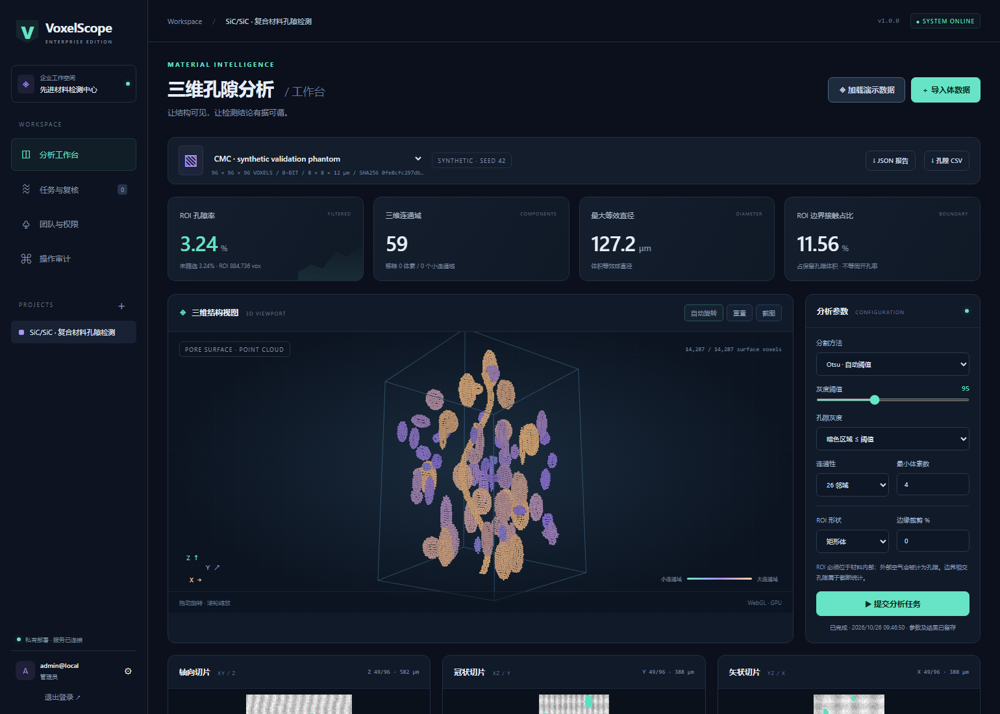
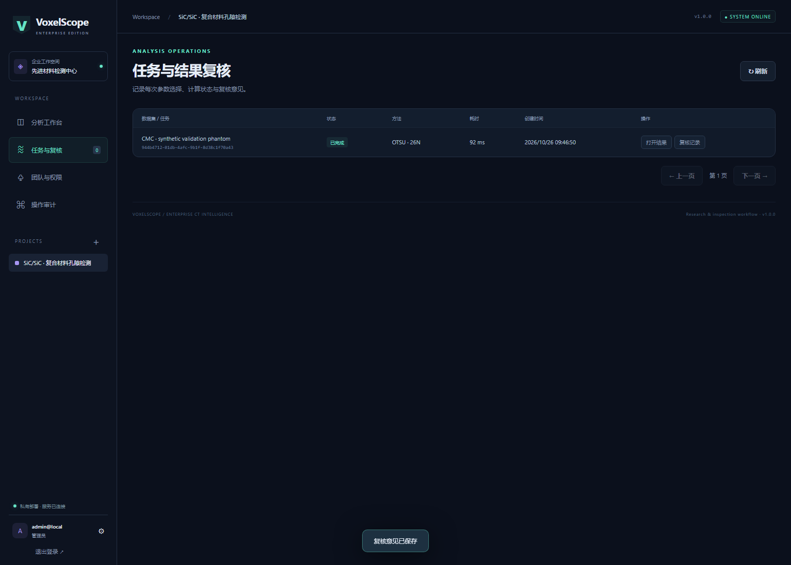
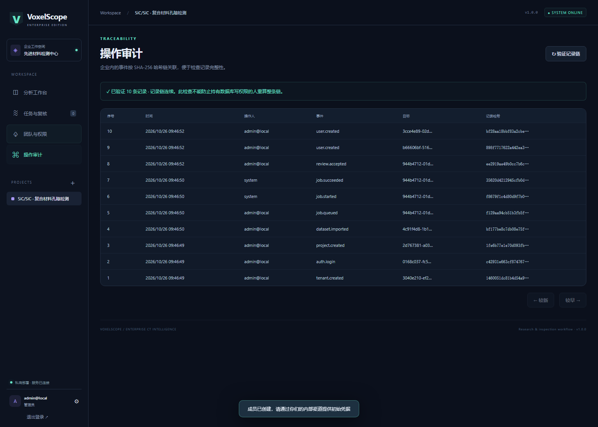

<div align="center">

# VoxelScope

### Enterprise CT Intelligence

**面向材料检测团队的自托管 CT 孔隙分析与协作平台**


[](https://github.com/perceivedreality11-cyber/voxelscope/actions/workflows/ci.yml)

[快速启动](#快速启动) · [使用手册](docs/USAGE.md) · [架构](docs/ARCHITECTURE.md) · [部署](docs/DEPLOYMENT.md) · [API](docs/API.md) · [English](README.en.md)

</div>



VoxelScope 将 **项目管理 → 体数据导入 → 三维可视化 → 孔隙测量 → 结果复核 → 审计追溯** 连接成可运行的工作流。数据和计算都留在你的部署服务器，浏览器无需访问第三方 API、CDN 或模型服务。

当前交付为 **企业工作流首版 / 内网试点基础**：已实现多人权限和企业隔离，适合小体积 ROI 与流程验证。单体数据限制为 **4,194,304 体素**，不适合直接处理数十 GB 的整件工业 CT；尚未经过真实企业负载、第三方渗透或计量精度认证。

## 系统架构示意图



浏览器负责交互与三维显示，服务端负责授权、数据留存与任务调度；独立计算线程执行孔隙分析。示意图对应当前已经实现的模块，详细数据关系见 [架构文档](docs/ARCHITECTURE.md)。

## CT 分析流程



## 更多运行界面

| 任务与结果复核 | 操作审计 |
|---|---|
|  |  |

以上截图来自真实运行程序，使用固定种子的合成 phantom 和测试账号。示意图为可编辑 SVG，可通过 `npm run docs:diagrams` 重新生成。

## 能做什么

| 能力 | 实际实现 |
|---|---|
| 企业工作空间 | 企业级数据隔离，服务端授权；管理工具可创建多个企业 |
| 团队权限 | 管理员 / 分析员 / 查看者；成员创建、停用、会话撤销、密码更改 |
| 项目与数据 | 按项目组织数据集，原生 8/16 位 RAW，PNG/JPEG/BMP 切片序列 |
| 三维工作台 | WebGL 孔隙表面点云、自动旋转、拖动缩放、截图、Canvas2D 降级 |
| 正交切片 | XY / XZ / YZ 浏览，保留孔隙叠色，按体素间距显示物理比例 |
| 分割与测量 | 手动 / Otsu 阈值、6 / 26 邻域、最小体素筛选、矩形或椭圆柱 ROI |
| 定量结果 | 孔隙率、体积、等效直径、物理质心、体素面面积、ROI 边界接触情况 |
| 趋势检查 | 沿 Z 孔隙率剖面、ROI 灰度直方图、五点阈值敏感性检查 |
| 后台任务 | SQLite 持久化排队，独立线程，取消与超时，重启中断标记 |
| 复核与追溯 | 追加式复核记录、输入 SHA-256 校验、算法版本与参数快照、审计哈希链 |
| 数据交付 | JSON 测量报告、全量连通域 CSV、三维 PNG 截图 |
| 部署与维护 | Docker Compose + HTTPS 反向代理、快照备份、管理员恢复工具、GitHub Actions |

## 快速启动

安装 **Node.js 24.x**。运行时不需要 `npm install`，所有依赖使用 Node 和浏览器内置能力。

```bash
git clone https://github.com/perceivedreality11-cyber/voxelscope.git
cd voxelscope
npm start
```

打开 **http://127.0.0.1:8787**。首次启动会在终端显示 `admin@local` 的随机初始密码。Windows 也可双击 `start.cmd`。

1. 登录，点击侧栏账户进入密码设置，修改初始密码并重新登录。
2. 创建检测项目，点击「加载演示数据」。
3. 系统生成固定种子 `42` 的合成体数据，自动提交分析。
4. 浏览三维孔隙和正交切片，修改参数后再提交任务。
5. 从任务页打开历史结果并填写复核意见；下载 JSON / CSV。
6. 在「团队与权限」添加成员，通过查看者账号验证只读流程。

演示体数据是程序生成的 **合成 phantom**，包含已知体素真值。界面截图全部来自实际运行程序；演示结果不代表真实工件的检测精度。

### 导入真实数据

- **RAW**：单文件 unsigned 8 / 16 位，X 最快、Y 次之、Z 最慢；支持大小端与文件头偏移，严格检查字节数。
- **切片**：至少 2 张同尺寸 PNG / JPEG / BMP，按文件名自然排序，例如 `slice2` 在 `slice10` 前。浏览器解码后转换为 8 位灰度；不保留 PNG 原始 16 位精度，不接受透明像素。
- **TIFF / DICOM**：当前不直接支持。请先用 CT 重建软件导出无符号 RAW 或受支持切片。
- **体素间距**：输入真实 XYZ 间距，单位 µm。16 位定量建议优先使用 RAW。
- **ROI**：必须包含材料内部的目标测量区。当前没有自动材料外轮廓掩膜，外部空气会被错误计入孔隙。

## 验证

```bash
npm run check
npm test
node scripts/benchmark.mjs
```

测试包含已知几何体的各向异性测量、16 位数据、连通性、筛选和边界情况，以及真实 HTTP 请求下的企业隔离、RBAC、CSRF、会话撤销、任务处理、审计和备份恢复。已执行结果见 [验证记录](docs/VALIDATION.md)。

可选真实浏览器回归：

```bash
npm install --no-save --package-lock=false playwright@1.62.1
npx playwright install chromium
node scripts/ui-smoke.mjs
```

浏览器脚本创建临时工作空间，验证完整用户流程，并生成 `docs/screenshots/` 中的截图；不会改动正式 `data/`。

## 部署与项目结构

本地默认只监听 `127.0.0.1`。网络部署使用 [部署手册](docs/DEPLOYMENT.md) 的 HTTPS 配置；Docker 编排已提供，但需要在你的目标机器构建验证。

```text
server/       HTTP API、授权、SQLite、后台队列与计算线程
src/          浏览器工作台、WebGL 渲染、可复用体分析算法
scripts/      备份、管理员维护、浏览器验证、性能测量
tests/        数值算法、HTTP 安全边界和运维回归
deploy/       HTTPS 反向代理配置
docs/         使用、架构、API、部署、验证与真实截图
.github/      Windows / Linux 测试与浏览器回归工作流
```

代码采用原生 JavaScript ES Modules，计算内核和 UI 分离。后端没有框架依赖，便于追踪完整请求链路。SQLite 的同步访问适用于当前单实例规模；它并非已经完成水平扩展的架构。

## 上传到 GitHub

只上传源码与文档。`.gitignore` 已排除数据目录、备份、日志、`.env` 与 RAW 工件文件。上传前请检查 `git status`。

```bash
git init -b main
git add .
git commit -m "Initial VoxelScope platform"
git remote add origin https://github.com/YOUR_USERNAME/voxelscope.git
git push -u origin main
```

本项目仓库为 [perceivedreality11-cyber/voxelscope](https://github.com/perceivedreality11-cyber/voxelscope)。向自己的空仓库上传时，把 `YOUR_USERNAME` 换成你的用户名。GitHub Actions 在 push 后运行，远端结果见 [Actions](https://github.com/perceivedreality11-cyber/voxelscope/actions)。解压源码包后上传、Git 身份设置和常见错误处理见 [GitHub 发布指南](docs/PUBLISHING.md)。

## 企业使用边界与下一步

当前为单实例 SQLite + 单分析线程，企业内成员共享该企业全部项目；没有项目级 ACL、SSO / MFA、四眼复核强制、分布式执行、自动数据保留策略或法规电子签名。每企业最多 200 项目、200 数据集、200 用户，最多 10 个待处理 / 2000 个历史任务。原始体数据额度为 512 MiB，结果文件另占空间，需要部署方监控磁盘。

完整工业 CT 的后续演进方向：分块体数据 / 金字塔浏览 → 对象存储 → PostgreSQL 与分布式任务队列 → OIDC / 项目级权限 → 真实 CT 与参考方法的计量验证。详见 [架构与演进](docs/ARCHITECTURE.md)。

MIT 协议允许商业使用。将它用于企业质量判定前，需要使用企业自己的扫描数据、参考样件与验收准则验证测量方法。具体计算定义见 [使用手册](docs/USAGE.md)。
