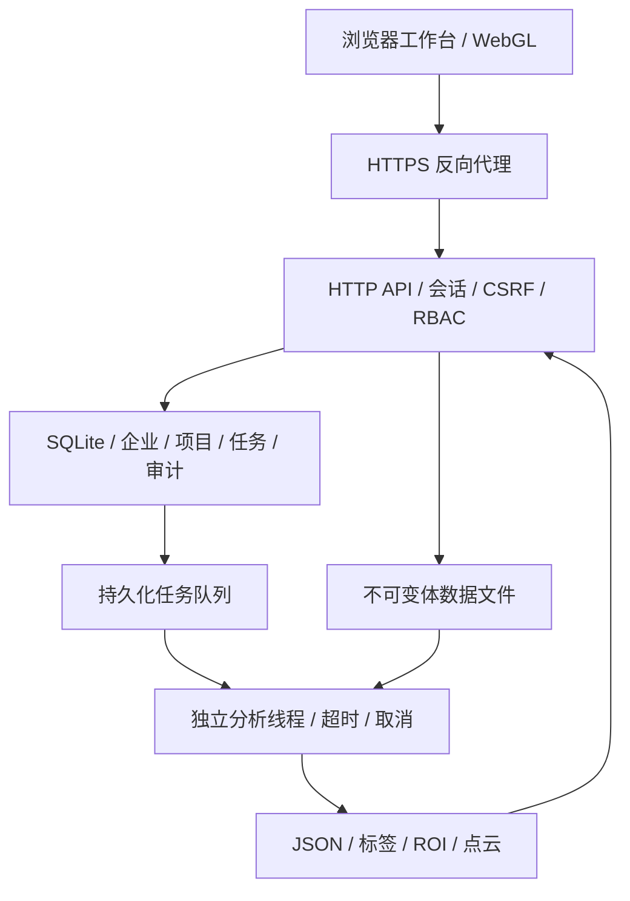
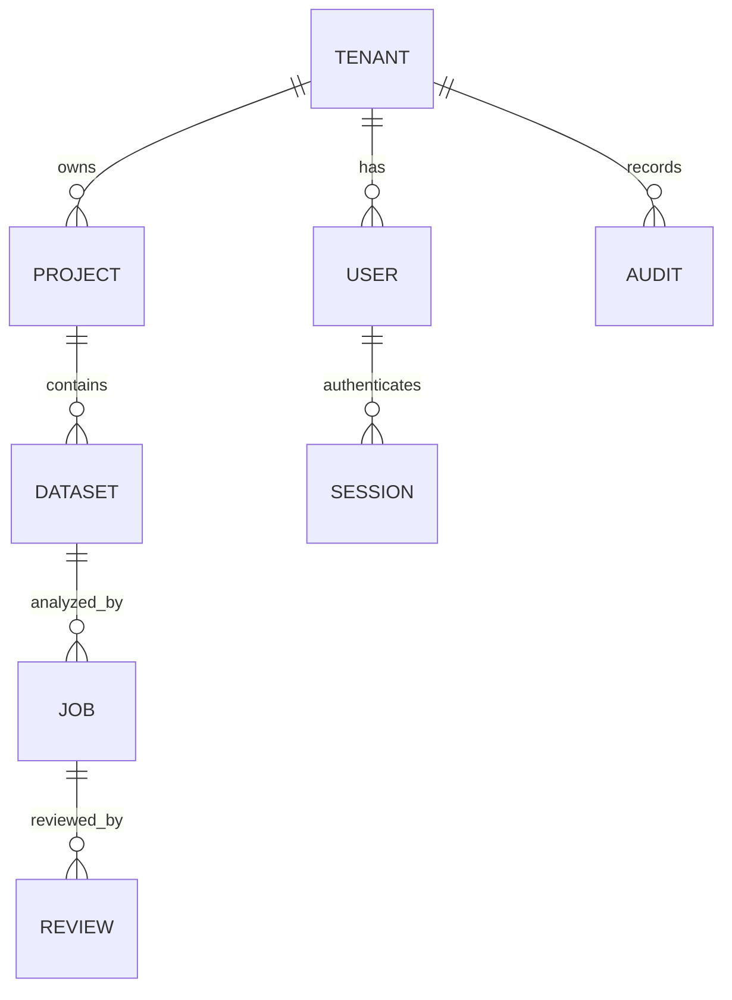
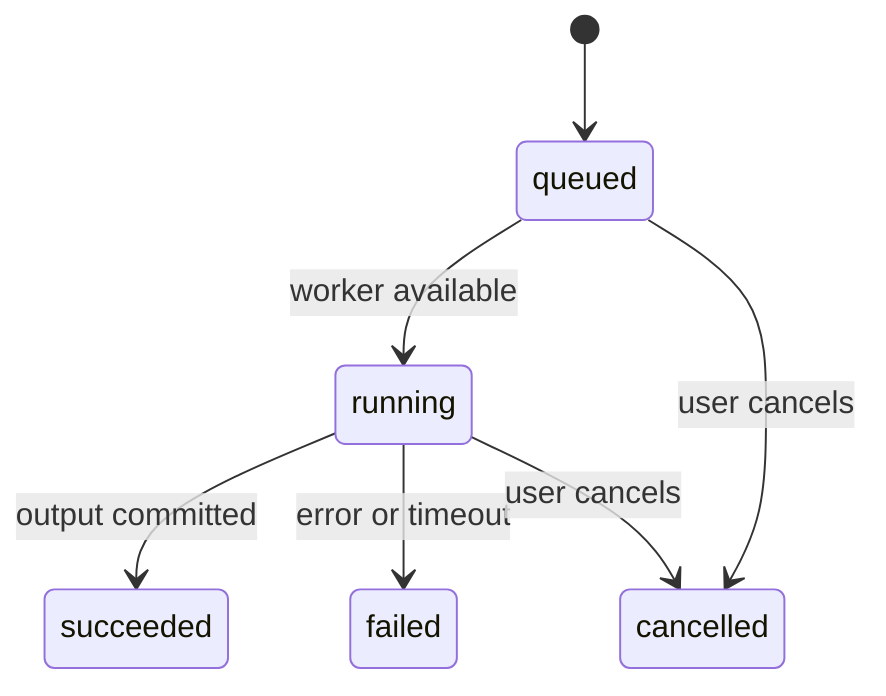

# 架构与演进

## 系统边界

当前是一个可自托管的单实例全栈应用。企业间数据隔离在 HTTP API 的每次资源查询中实现。浏览器隐藏按钮只改善交互，不承担授权。

两张图的可编辑源代码位于 `scripts/diagrams.mjs`，运行 `npm run docs:diagrams` 可重新生成。

运行时使用 Node 24 内置 HTTP、SQLite、crypto、worker_threads 与浏览器 Canvas / WebGL。Playwright 仅为可选开发验证工具。没有外部 AI 服务、遥测或运行时 CDN 请求。

## 模块职责

| 模块 | 职责 |
|---|---|
| `server/app.js` | 路由、认证授权、参数约束、上传、项目/人员/复核 API |
| `server/store.js` | SQLite schema、预编译查询、事务、审计哈希链 |
| `server/auth.js` | scrypt 密码派生、随机令牌、会话哈希、Cookie |
| `server/queue.js` | FIFO 队列、状态转移、并发限制、取消、超时、恢复 |
| `server/analysis-worker.js` | 校验输入指纹、执行算法、写出结果文件 |
| `src/core.js` | 无 IO 的确定性算法，可独立导入与测试 |
| `src/renderer.js` | WebGL 点云渲染及兼容模式 |
| `src/app.js` | 登录、项目导航、上传、工作台、管理、结果导出 |

## 数据关系

所有资源都保留 `tenant_id`。项目 ID、数据集 ID 和任务 ID 由服务器生成 UUID，客户端不能指定 tenant。查看某一资源时同时匹配资源 ID 和当前登录用户的 tenant。

元数据与会话保存在 SQLite，RAW 规范化体素保存在 `volumes/<uuid>.bin`，结果保存在 `results/<job-uuid>/`。静态文件服务采用明确白名单，不会提供数据库、`.env`、备份或服务端代码。

上传先预留数据库额度，文件写入成功后标为 ready；未 ready 的数据不能触发计算。体数据不可通过 API 覆盖，重复分析产生新的任务和结果目录。结果文件全部写成功后才将任务标为 succeeded。复核和审计只追加，没有删除 / 覆盖接口。

## 任务状态

任务从数据库恢复：queued 在启动后继续，running 在进程重启后标记 failed 并记录中断审计事件。取消不删除历史任务。每次计算单独启动 worker，默认最长 120 秒，V8 堆上限 384 MiB；这不是对进程总 RSS 的严格内存限额，容器再设置 1 GiB 限额。

## 安全设计

- 密码为随机盐 scrypt (`N=32768,r=8,p=1`)，不存明文。
- 会话使用 256 位随机令牌，数据库只存令牌 SHA-256；Cookie 为 HttpOnly / SameSite=Strict，HTTPS 模式启用 Secure。
- 变更请求检查 CSRF token、Origin 和 cross-site fetch metadata。不信任转发的 Host / Proto；代理场景显式设置 PUBLIC_ORIGIN。
- SQL 参数化；HTML 插值转义；限制静态来源的 CSP；请求体和图片导入体素量设上限。
- 同时最多 4 个密码派生，按连接源 IP 限制登录。HTTPS 代理后的连接共享代理 IP，当前限流会影响同一代理下所有用户，见部署限制。
- SHA-256 在体数据导入时计算，在每次分析前复核。报告记录输入哈希、版本、任务及参数。

审计链按企业分开，哈希材料为前一条哈希及规范字段。它能发现相对当前链的记录修改，但没有外部可信锚点；数据库管理员可以重算整链或删除尾部。这是可检查的操作日志，不是防篡改合规存储。

## 扩展路线

| 需要解决的问题 | 建议下一阶段 |
|---|---|
| 超大整件 CT | 分块体存储、金字塔切片、流式加载、分块连通域拼接；先建立计量对照用例 |
| 多计算节点 | PostgreSQL + 外部队列 + 独立计算服务；幂等领取、租约和任务重试策略 |
| 多团队权限 | OIDC / SAML、MFA、项目级 ACL、服务账号、独立审核职责 |
| 长期数据留存 | S3 兼容对象存储、数据生命周期、外部审计锚点、异地备份与恢复演练 |
| 企业交付 | 真实样件验证、并发与容量测试、渗透测试、SBOM、依赖镜像固定和变更审核 |

当前不包含这些尚未实现的能力，也不支持多个应用实例同时操作同一 DATA_DIR。SQLite 同步访问、单队列和本地文件存储是首版刻意保留的规模边界。
